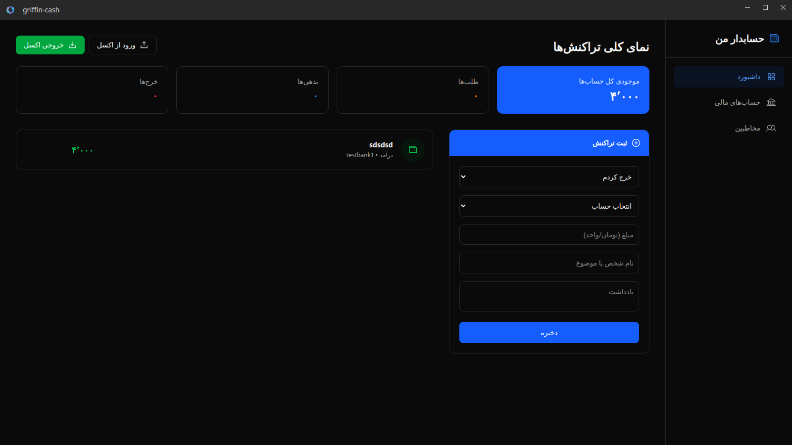

# 🦅 Griffin Cash

> A privacy-first, offline personal finance and debt management dashboard built with Electron, React, and SQLite.

[](https://www.gnu.org/licenses/gpl-3.0)
[](https://reactjs.org/)
[](https://www.electronjs.org/)
[](https://www.sqlite.org/)


**Griffin Cash** is a fast and secure desktop application designed to help you manage your personal finances, track multiple accounts (Fiat, Crypto, Cash), and keep a precise ledger of your debts and loans without relying on cloud services. All your financial data is stored locally on your machine.

[]


## ✨ Features

- **🛡️ 100% Offline & Private:** Your data never leaves your computer. Everything is stored in a local SQLite database (`userData` directory).
- **💼 Multi-Account Management:** Create and track balances across various accounts including Bank accounts (Fiat), Crypto wallets, and Cash.
- **🔄 Smart Transfers:** Move funds between your accounts seamlessly without affecting your net income or expense logic.
- **👥 Contacts & Debt Tracking:** Automatically calculates how much you owe or are owed by specific individuals based on `Lend` and `Borrow` transactions.
- **📅 Due Dates:** Set calendar due dates for borrowed or lent money.
- **🌗 Dark/Light Mode:** Beautiful, responsive UI built with Tailwind CSS that respects your system's theme.
- **⚡ Lightning Fast IPC:** Utilizes a custom, type-safe IPC wrapper (Conveyor) with Zod runtime validation.

## 🛠️ Tech Stack

- **Frontend:** React, TypeScript, Tailwind CSS, Phosphor Icons
- **Backend/Desktop:** Electron, Node.js
- **Database:** `better-sqlite3` (Synchronous, high-performance SQLite driver)
- **Validation:** Zod
- **Build Tool:** Vite, electron-vite

## 🚀 Getting Started

### Prerequisites
Make sure you have Node.js and `pnpm` installed on your system.

### Installation

1. Clone the repository:
   ```bash
   git clone [https://github.com/yourusername/griffin-cash.git](https://github.com/yourusername/griffin-cash.git)
   cd griffin-cash

    Install dependencies:
    Bash

    pnpm install

    Important: Rebuild the native SQLite module for Electron's Node environment:
    Bash

    npx electron-rebuild -f -w better-sqlite3

    Start the development server:
    Bash

    pnpm run dev

🏗️ Project Architecture

Griffin Cash uses a strict Separation of Concerns (SoC) architecture:

    lib/conveyor/: A fully type-safe IPC bridge. It uses Zod schemas (finance-schema.ts) to validate data traveling between the React frontend and the Electron main process.

    lib/conveyor/handlers/: Contains the SQLite logic (finance-handler.ts).

    app/hooks/useFinance.ts: The central React hook that communicates with the API and manages the frontend state.

    app/components/: Modular, reusable UI components.

📦 Building for Production

To package the application for your operating system:
Bash

# Build for your current platform
pnpm run build

The compiled binaries will be available in the dist/ or out/ directory.
🤝 Contributing

Contributions, issues, and feature requests are welcome! Feel free to check the issues page.
📜 License

This project is licensed under the GNU General Public License v3.0 (GPL-3.0).
See the LICENSE file for details. You are free to use, modify, and distribute this software, provided that any derivative works are also open-source and licensed under GPLv3